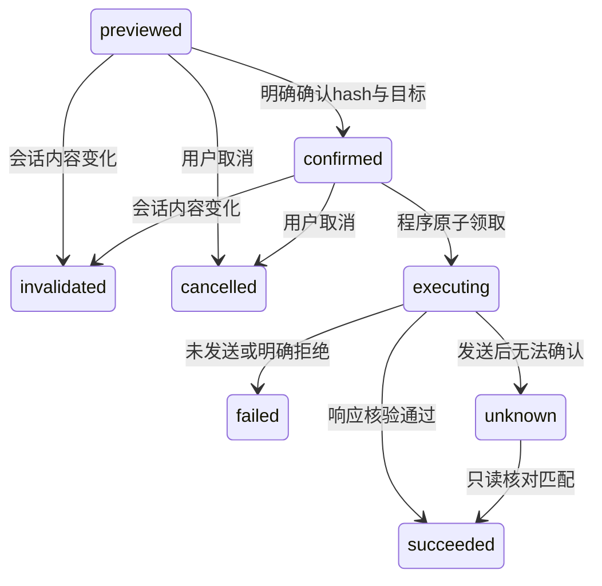

# V4：确认为什么必须写在程序里

## 1. 预览的是实际将发送的内容

OperationStore.preview 从会话读取固定repository/issue_number和当前draft，创建不可编辑的操作快照。评论末尾加唯一HTML标记；目标、kind、完整payload共同计算SHA256，返回给用户查看。添加标签则只接受1至5个不重复标签名，空数组被拒绝。

确认接口只接受hash和完整confirmation_text。它同时核对source_revision、目标、有效期及状态，不从Issue正文、模型答案、工具结果里解释“用户已同意”。confirm成功仅记confirmed；execute才领取执行权。旧操作无法就地修改，要改内容先改草稿再生成新预览。

为什么需要版本号：即使正文改成A又改回原文，revision也已变化，旧确认仍失效。StateStore.invalidate_operations会把previewed/confirmed变为invalidated，原操作events留下原因。测试验证确认后改稿、补充/重新分析、到期及目标变化。

## 2. 真实权限在发送前再次检查

GitHubWriter.preflight固定GET /user、GET允许仓库、GET指定Issue；拒绝非公开、归档、无仓库写权限、PR和锁定Issue。标签通过GET /labels/{name}逐个验证，不使用“创建标签”接口。

本地策略要求push/maintain/admin；这比GitHub的一些合法角色更保守。返回的仓库权限是账号权限，不证明fine-grained token的Issues写scope；GitHub实际写入接口仍可返回403，程序记录failed，不绕过。

所有URL都由程序基于配置仓库和整数Issue号拼接，标签名单独URL编码。Authorization只在HTTP层注入；不把token传入模型、预览或结果。模型的MCP工具列表保持两个只读工具。用户直接调用新HTTP接口执行授权动作，不由模型决定是否已获确认。

## 3. 为什么先写SQLite再发POST

OperationStore.claim用BEGIN IMMEDIATE把confirmed变为executing。同一操作两个并发调用只有一个得到fresh=True；其他调用只看到现有状态。权限检查通过后，dispatched先保存actor、dispatch_started=True、attempts=1，再由GitHubWriter.send发一次POST。

这个顺序无法把数据库和GitHub做成跨系统原子事务，但能保守处理崩溃：持久化意图之后、真正发出之前崩溃也会恢复unknown，而不是冒险重发。attempts=1代表持久化的一次发送意图，不保证请求已经到达远端。

confirmed只允许一次执行；failed不能直接执行。仅对明确的401/403/429拒绝，在修正原因后可以用原content_hash、完整确认文本及retry_after_attempt=N显式重确认。程序核对失败次数、当前草稿版本和目标，重新给出15分钟有效期；累计最多3次发送。旧确认不能重放到下一次失败，unknown仍不可重发。相同成功内容的fingerprint还用于跨会话去重。换会话不能绕开同一Issue上未知结果的阻断。测试实际断言MockTransport的POST计数，不只检查函数返回值。

## 4. timeout不是“没有发出去”

发送前超时为failed；POST时超时、连接故障、5xx、重定向或无法核验的响应为unknown。明确4xx拒绝为failed，408单独按unknown处理。执行被取消/总预算耗尽时也根据发送意图区分。

reconcile只发GET。评论精确比较完整body、标记、作者ID与issue_url，最多3页、每页100条；还支持指定comment_id。未找到不能证明不存在，因此状态仍unknown；标签核对的是当前期望标签已存在。

演示脚本中的timeout场景先把评论写入模拟远端，再抛ReadTimeout。第一次执行unknown，重复execute没有第二个POST；GET核对后变succeeded，post_count仍为1。这是可复现的故障模型，不是声称在真实GitHub人为制造了丢包。

unknown没有自动回到executing的边。即使评论被删除或编辑导致永远无法精确匹配，V4也保留未知状态；这是当前恢复能力的限制。

## 5. 可维护性与实际问题

StateStore保存会话，OperationStore保存操作；会话的pending_operations/operation_status根据操作表计算，不维护另一套重复状态。聊天历史和模型上下文不包含确认对象。每会话最多50条操作，事件列表只记录实际状态转换。

V4仍是单用户本地程序。Host/Origin检查降低网页跨站触发风险，不能替代登录认证。开发中普通HTTP中间件破坏了旧断线测试，改为纯ASGI直接转发receive/send后恢复，原因和测试结果见验证记录。

新增功能没有改变检索距离、切分、Embedding或回答提示词。V2/V3的回答质量问题依然存在，用户应审阅将要公开的完整草稿。

## 权限修正的代码入口

`app/operations.py` 的 `Confirmation.retry_after_attempt` 将重确认绑定到已知失败次数；`app/operation_store.py` 的 `confirm` 只允许上述拒绝状态恢复为confirmed，`dispatched` 累计发送次数。`tests/test_operations.py` 新增3个案例验证同一内容重试、旧确认防重放、unknown不重发。本次37项写入测试全部通过。
